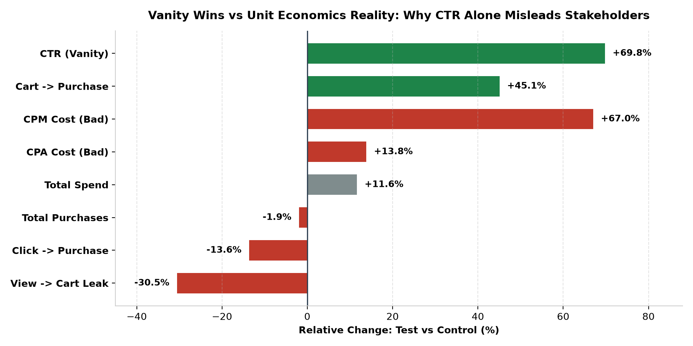
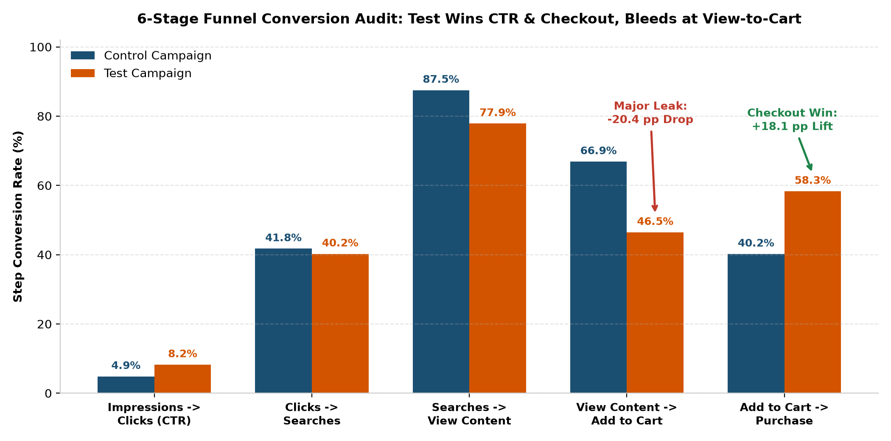
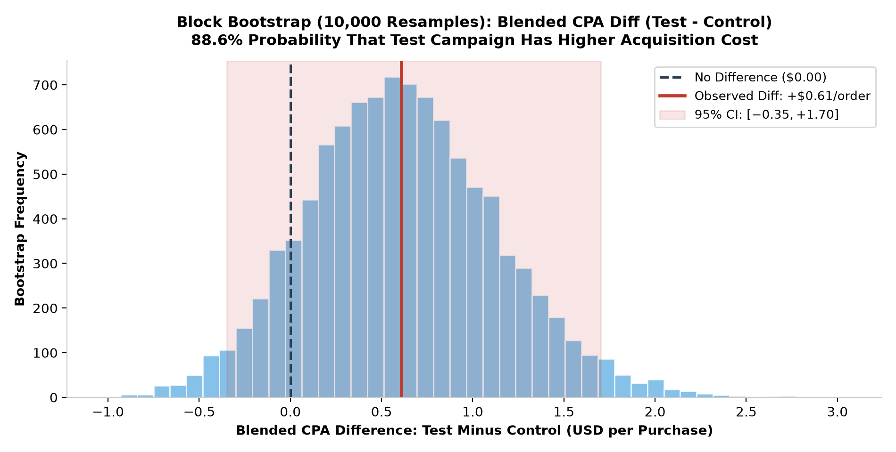
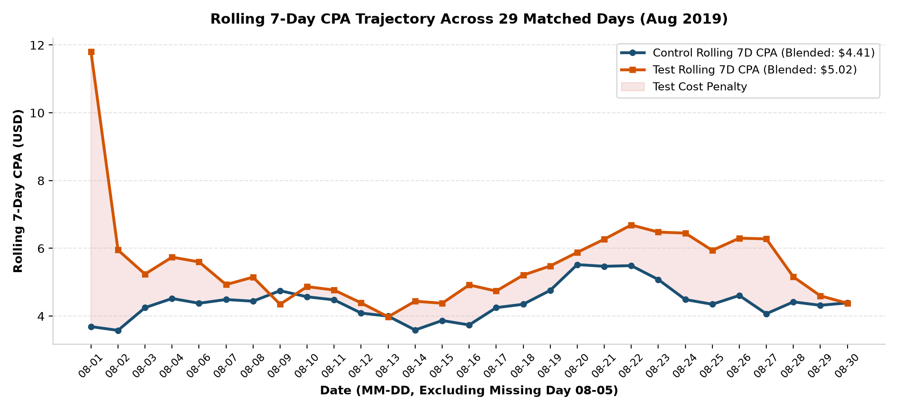

# E-Commerce Marketing Funnel & A/B Testing Analytics

An end-to-end **Product & Growth Analytics** project auditing a 30-day e-commerce paid acquisition A/B test (`Control` vs. `Test` campaign) across a 6-stage conversion funnel (`Impressions → Clicks → Searches → View Content → Add to Cart → Purchase`).

Instead of relying on vanity metrics (CTR) or naive pooled Z-tests, this project pairs **SQL funnel modeling** with **paired-day non-parametric tests and 10,000-iteration block bootstrapping** to deliver an executive **Ship / No-Ship** decision backed by quantified budget ROI.

---

## Executive Verdict: DO NOT SHIP Test Campaign As-Is

| KPI (29 Strictly Matched Days) | Control | Test | Delta (Test vs. Ctrl) | Statistical Evidence |
| :--- | ---: | ---: | ---: | :--- |
| **Total Ad Spend** | $66,818 | $74,595 | **+11.6%** (+$268/day) | Significant (Paired *t* `p = 0.0108`) |
| **Total Purchases** | 15,161 | 14,869 | **-1.9%** (-10/day) | No Lift (Paired *t* `p = 0.8380`) |
| **Blended CPM ($ / 1k Imp)** | $21.03 | $35.13 | **+67.1%** (+$14.10) | Significant (Boot CI `[+$9.48, +$20.15]`, `p < 0.0001`) |
| **Blended CPA ($ / Order)** | $4.41 | $5.02 | **+13.8%** (+$0.61) | 88.6% Boot Prob. Test is Costlier (`p = 0.2274`) |
| **CTR (Clicks / Imp)** | 4.86% | 8.25% | **+69.8%** (+3.39 pp) | Significant Win (Paired *t* `p = 0.0004`) |
| **View Content → Add to Cart** | 66.88% | 46.45% | **-30.6%** (-20.43 pp) | Significant Leak (Paired *t* `p = 0.0013`) |
| **Add to Cart → Purchase** | 40.21% | 58.33% | **+45.1%** (+18.12 pp) | Significant Win (Paired *t* `p = 0.0124`) |
| **Click → Purchase (Site CVR)** | 9.83% | 8.49% | **-13.6%** (-1.33 pp) | Boot CI `[-3.84, +0.86]` (`p = 0.2406`) |

### Key Financial Impact
* **Direct Cost Avoidance:** Achieving Test's `14,869` purchases at Control's `$4.41` CPA saves **$9,064 per 29 days (~$114,080/year annualized)**.
* **Volume Upside at Flat Spend:** Reallocating Test's `$74,595` spend to Control's efficiency yields **~16,926 orders (+2,057 orders/month, or +25,885/year)**.

---

## Critical Data Audit Findings (Why Raw Data Lies)

1. **The Aug 5 Denominator Trap (Headline Reversal):** Control missed all funnel logs on `2019-08-05` while still recording Ad Spend. Raw uncleaned totals showed Test winning purchases by **+3.1%** (`15,637` vs `15,161`). Excluding `2019-08-05` from **both** campaigns to enforce 29 matched calendar days reversed the result to **-1.9% fewer orders** (`14,869` vs `15,161`).
2. **Cross-Day Attribution Lag Transparency:** Control recorded `670` purchases vs. `442` add-to-carts on `2019-08-30` due to delayed checkout attribution; explicitly flagged via `attribution_lag_flag` in SQL rather than silently dropped.
3. **No Simpson's Paradox:** Control maintained lower CPA across both **Weekdays** (`$4.23` vs. `$4.78`) and **Weekends** (`$5.01` vs. `$5.87`).
4. **Avoiding Pseudoreplication:** Event-level two-proportion Z-tests on millions of impressions yield `p < 0.0001` for every metric by treating clicks as independent. Pairing them with **daily-level tests (`n = 29`)** and **10,000-iteration block bootstrapping** for ratio metrics (`Blended CPA`) prevented false-positive shipping.

---

## Visual Walkthrough

### 1. Vanity Metrics vs. Unit Economics Reality


### 2. 6-Stage Funnel Diagnosis: Mid-Funnel Leak vs. Checkout Win


### 3. Block Bootstrap CPA Distribution & Rolling 7-Day Trend



---

## Strategic Recommendations
1. **Hold Full Rollout:** Keep Control bidding as the baseline to protect `$4.41` CPA and avoid `~$114K/yr` in acquisition cost inflation.
2. **Audit Product Page → Cart Friction:** Investigate why `53.6%` of Test product viewers drop before Add-to-Cart (message-match gap, pricing surprise, or mobile page speed).
3. **Run a 2×2 Hybrid Follow-Up Test:** Combine **Control's lower-CPM bidding ($21.03 CPM)** with **Test's high-CTR creative (8.25%)** and **streamlined checkout flow (58.3% Cart→Purchase)**.

---

## Repository Structure & Deliverables

```text
product-funnel-ab-testing/
├── data/
│   ├── raw/                             # Raw semicolon-delimited Control & Test CSVs
│   └── processed/bi_exports/            # Clean SQL view exports & hypothesis test tables
├── sql/
│   └── funnel_views.sql                 # 5 modular SQLite views (paired daily, funnel, DOW, rolling 7D CPA)
├── scripts/
│   ├── 01_data_audit.py                 # Delimiter, null, funnel-logic & outlier audit
│   ├── 02_build_db_and_views.py         # SQLite ETL pipeline & automated validation checks
│   └── 03_stats_charts_deck.py          # Z-tests, paired t/Wilcoxon, 10k bootstrap, charts & PPTX generator
├── outputs/
│   ├── 01_audit_report.md               # Phase 1 raw experiment integrity report
│   └── 02_statistical_report.md         # Phase 3 full hypothesis testing & ROI memo
└── deck/
    ├── AB_Test_Executive_Decision_Deck.pptx  # 5-slide executive readout deck
    └── charts/                          # High-DPI visual exports
```

## How to Reproduce

```bash
python3 scripts/01_data_audit.py
python3 scripts/02_build_db_and_views.py
python3 scripts/03_stats_charts_deck.py
```